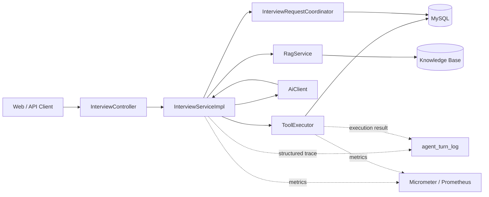

# AI Interviewer

面向生产级场景设计的 AI 模拟面试官系统，基于 Spring Boot、RAG 和受控 Function Calling 实现多阶段技术面试。

系统支持候选人提交简历、AI 动态出题、回答熟悉度评估、连续追问、话题切换、自动结束、阶段晋级和重试。工程实现重点关注并发一致性、请求幂等、数据库事务边界、离线确定性评测、调用轨迹和运行指标，而不只是完成一次大模型对话。

## 项目定位

AI Interviewer 将大模型限制在明确的业务状态机中：

- 大模型负责理解回答并选择受控工具。
- `ToolExecutor` 负责参数校验和业务状态变更。
- RAG 为不同面试阶段提供知识上下文。
- MySQL 保存面试会话、消息、评分、幂等状态和调用轨迹。
- Session Lease 防止同一会话被多个实例并发处理。
- Micrometer 和 `agent_turn_log` 分别提供聚合指标与结构化调用证据。
- 30 条离线确定性评测作为核心业务逻辑基线，不依赖真实模型输出。

## 技术栈

| 分类 | 技术 |
| --- | --- |
| 语言 | Java 21 |
| 应用框架 | Spring Boot 4.1.1 |
| Web | Spring Web MVC、WebFlux |
| ORM | MyBatis-Plus |
| 数据库 | MySQL 8.0 |
| 大模型 | DeepSeek Chat Function Calling |
| Embedding | 智谱 AI embedding-3 |
| RAG | 本地知识库、余弦召回、可选 TypeSafe Jev 重排 |
| 可观测性 | Spring Boot Actuator、Micrometer、Prometheus |
| 测试 | JUnit 5、Mockito、真实 MySQL 集成测试 |
| 构建 | Maven |

## 核心架构



核心调用链可以概括为：

```text
Controller
  -> InterviewServiceImpl
     -> RagService 构建面试上下文
     -> AiClient 请求受控工具决策
     -> ToolExecutor 校验并执行工具
     -> MySQL 持久化业务结果
     -> agent_turn_log 异步记录调用轨迹
     -> Micrometer 聚合运行指标
```

`AiClient` 只负责模型协议和 HTTP 调用，不直接修改业务状态。`ToolExecutor` 是工具参数校验、轮次推进、评分写入和终态更新的统一入口。

## 面试流程

```text
创建会话
  -> 获取首题
  -> 候选人回答
  -> RAG 检索上下文
  -> 模型选择 ask_followup / change_topic / finish_interview
  -> ToolExecutor 校验并执行
  -> 继续追问、切换话题或结束
  -> 生成报告
  -> 晋级下一阶段或重试
```

系统采用三阶段面试：

| 阶段 | 通过分数 |
| --- | ---: |
| 一面 | 6.0 |
| 二面 | 6.5 |
| 三面 | 7.0 |

## 工程亮点

### 并发幂等

`POST /api/session/{id}/chat` 要求客户端提交非空 `requestId`。

数据库通过 `interview_request` 表中的唯一约束保证：

```text
UNIQUE(session_id, request_id)
```

并发请求不会依赖 JVM 本地锁。多个应用实例竞争同一个 `sessionId + requestId` 时，由数据库唯一索引决定唯一执行者。

重复插入触发 `DuplicateKeyException` 后，系统回读已有记录：

| 已有状态 | 行为 |
| --- | --- |
| `PROCESSING` | 返回 HTTP 409：相同请求正在处理 |
| `COMPLETED` | 返回已保存的业务结果 |
| `FAILED` | 返回 HTTP 409，要求客户端生成新的 `requestId` |
| 不存在 | 创建记录并开始处理 |

失败记录保留 `expires_at`，当前清理边界为 24 小时。系统不会自动复用失败的旧 `requestId`。

### 数据库 Session Lease

同一会话的跨请求并发控制使用数据库条件更新：

```text
UPDATE interview_session
SET lease_owner = ?, lease_expires_at = ?
WHERE id = ?
  AND status = 'IN_PROGRESS'
  AND (
      lease_owner IS NULL
      OR lease_expires_at < ?
      OR lease_owner = ?
  )
```

Lease 获取和释放均为独立的 `REQUIRES_NEW` 短事务。

AI 网络调用期间不持有数据库事务，避免慢调用长期占用数据库连接或行锁。实现不依赖 `synchronized`、`ReentrantLock` 或其他 JVM 级锁，可用于多实例部署。

### 受控工具状态机

模型不能直接修改面试状态，只能从当前上下文允许的工具集合中选择：

| 工具 | 职责 |
| --- | --- |
| `ask_followup` | 继续追问当前话题 |
| `change_topic` | 完成当前评价并进入下一话题 |
| `finish_interview` | 计算成绩并结束面试 |

系统会拒绝以下情况：

- 未知工具名。
- 当前阶段未提供的工具。
- 一次返回多个工具调用。
- 工具缺少 `function`。
- `arguments` 不是合法 JSON。
- 必填参数缺失或字段类型错误。
- 熟悉度枚举与工具语义不匹配。
- 首题阶段尝试调用 `finish_interview`。
- 超过当前话题追问上限。

模型未按协议调用工具时，系统会在有限预算内纠正。纠正耗尽或 AI 服务不可用时，走非终结降级，不直接错误结算候选人成绩。

### 结构化调用轨迹

V4 使用 `agent_turn_log` 保存结构化模型调用和工具执行轨迹。

记录内容包括：

- `session_id`
- `request_id`
- `trace_id`
- 面试轮次和调用序号
- 调用上下文
- 模型与工具名称
- 最终决策
- `finish_reason`
- 熟悉度
- 降级原因
- token 用量
- 模型耗时
- 标准错误码
- 截断后的错误摘要

系统不保存完整简历、Prompt、用户回答或模型原文，降低敏感信息泄漏和日志表膨胀风险。

轨迹通过专用有界线程池异步写入：

```text
ThreadPoolExecutor(
    1,
    2,
    30 seconds,
    ArrayBlockingQueue(256),
    DiscardPolicy
)
```

轨迹写入使用独立短事务。队列满或数据库写入异常时只记录告警，不阻塞面试主流程。该方案是 best-effort，应用进程异常退出时允许少量尚未落库的轨迹丢失。

### Micrometer 可观测性

系统通过 Micrometer 提供以下核心指标：

| 指标 | 类型 | 说明 |
| --- | --- | --- |
| `interviewer.ai.model.calls` | Counter | 模型调用次数 |
| `interviewer.ai.model.latency` | Timer | 模型调用耗时 |
| `interviewer.ai.model.tokens` | Counter | 输入和输出 token 总量 |
| `interviewer.ai.tool.executions` | Counter | 工具执行和拒绝次数 |

主要标签：

| 指标 | 标签 |
| --- | --- |
| `interviewer.ai.model.calls` | `context`、`decision`、`tool` |
| `interviewer.ai.model.latency` | `context`、`decision`、`tool` |
| `interviewer.ai.model.tokens` | `direction`、`context` |
| `interviewer.ai.tool.executions` | `context`、`decision`、`tool`、`proficiency` |

指标不使用 `sessionId`、`requestId`、`traceId` 或文本内容作为标签，避免高基数时序和敏感信息泄漏。非法模型工具名统一归一化为 `unknown`。

Actuator 暴露以下端点：

```text
GET /actuator/health
GET /actuator/info
GET /actuator/metrics
GET /actuator/metrics/interviewer.ai.model.calls
GET /actuator/prometheus
```

### 离线确定性评测

系统不使用真实大模型的随机输出作为核心业务回归基线。

30 条离线评测通过固定 fixture 和 Mockito 替换 AI、Embedding HTTP、TypeSafe 与 Mapper 外部依赖，覆盖：

- 工具参数校验。
- 首题工具限制。
- 追问与换题状态转换。
- 熟悉度约束。
- 协议纠正和降级。
- AI 异常降级。
- 面试结束和成绩结算。
- RAG 召回与降级。
- 重排服务异常回退。
- 阶段晋级与重试。
- Mapper 交互契约。
- Maven 测试分类配置。

每次执行默认测试都会生成：

```text
docs/EVALUATION_REPORT.md
```

当前离线评测结果为 30/30，成功率 100.0%。

## 系统健壮性

### 边界输入拦截

系统对关键输入进行显式约束：

- `/chat` 请求中的 `answer` 使用 `@NotBlank` 校验。
- `/chat` 请求中的 `requestId` 使用 `@NotBlank` 校验。
- 简历最大长度为 2000 字。
- 面试阶段只能是 1、2、3。
- 工具 arguments 必须是合法 JSON 对象。
- 工具必填字段、字段类型和熟悉度枚举均会校验。
- RAG 查询进入检索链路前限制长度。
- 面试轮次、追问次数和协议纠正次数均有硬边界。

### 越权校验

业务接口通过认证拦截器解析用户身份，并写入线程级 `UserContext`。

读取首题、提交回答、查看报告、查看逐题评估、晋级和重试前都会执行会话所有权校验，防止用户通过修改 `sessionId` 访问其他用户的面试数据。

请求结束后会清理 `ThreadLocal`，避免线程复用导致身份泄漏。

### 异常信息脱敏

系统通过全局异常处理器统一转换业务异常、参数校验异常和未预期异常。

面向客户端的响应使用受控错误码和业务消息，不直接返回数据库堆栈、SQL、内部类名或第三方服务响应正文。

幂等失败记录只保存截断后的异常摘要。调用轨迹不保存完整 Prompt、简历、用户回答或模型原文。

### 外部服务降级

- AI 服务异常时走非终结追问降级，不直接结束面试。
- 模型协议违规会有限次纠正，防止无限循环。
- TypeSafe Jev 不可用或调用失败时回退到余弦排序。
- 轨迹写入失败不会影响主业务。
- 指标记录失败不会影响主业务。
- Session Lease 带过期时间，避免实例崩溃后永久占用会话。
- 面试终态通过条件更新，避免重复结算。

## API 示例

### 创建会话

```http
POST /api/session
Authorization: <token>
Content-Type: application/json

{
  "resume": "候选人简历",
  "targetPosition": "Java 后端工程师",
  "position": "java"
}
```

### 提交回答

每次用户主动提交都应生成新的 `requestId`。网络重试必须复用原 `requestId`。

```http
POST /api/session/{sessionId}/chat
Authorization: <token>
Content-Type: application/json

{
  "answer": "候选人的回答",
  "requestId": "由客户端生成的唯一请求 ID"
}
```

完整接口示例见：

```text
src/main/java/com/interviewer/ai/test.http
```

## 本地启动

### 环境要求

- JDK 21
- Maven 3.9+
- MySQL 8.0

### 创建数据库

```sql
CREATE DATABASE interviewer_ai
    CHARACTER SET utf8mb4
    COLLATE utf8mb4_unicode_ci;
```

初始化基础表后执行增量迁移：

```text
sql/add_user_table.sql
migration_v3.sql
migration_v4.sql
```

`migration_v3.sql` 增加 requestId 幂等记录和 Session Lease。

`migration_v4.sql` 增加结构化调用轨迹表 `agent_turn_log`。

迁移脚本是一次性脚本。数据库已经完成对应迁移时，不要重复执行。

### 配置环境变量

PowerShell 示例：

```powershell
$env:DB_USERNAME = "root"
$env:DB_PASSWORD = "your-password"
$env:DEEPSEEK_API_KEY = "your-deepseek-key"
$env:ZHIPUAI_API_KEY = "your-zhipu-key"
$env:TYPESAFE_API_KEY = ""
$env:TYPESAFE_ENABLED = "false"
$env:ADMIN_TOKEN = "your-admin-token"
$env:APP_BASE_URL = "http://localhost:8080"
```

主要配置：

| 环境变量 | 必需 | 默认值 | 说明 |
| --- | --- | --- | --- |
| `DB_USERNAME` | 否 | `root` | MySQL 用户名 |
| `DB_PASSWORD` | 是 | 无 | MySQL 密码 |
| `DEEPSEEK_API_KEY` | 是 | 无 | DeepSeek API Key |
| `ZHIPUAI_API_KEY` | 是 | 无 | 智谱 Embedding API Key |
| `TYPESAFE_API_KEY` | 否 | 空 | TypeSafe Jev API Key |
| `TYPESAFE_ENABLED` | 否 | `true` | 是否启用 Jev 重排 |
| `ADMIN_TOKEN` | 是 | 无 | 管理员接口 Token |
| `APP_BASE_URL` | 否 | 配置文件默认值 | 应用访问地址 |

### 编译

```powershell
mvn -q clean compile
```

### 启动

```powershell
mvn spring-boot:run
```

启动后访问：

```text
http://localhost:8080/
http://localhost:8080/actuator/health
http://localhost:8080/actuator/prometheus
```

## 测试分类

JUnit 测试使用 `@Tag` 分类。Maven Surefire 默认排除外部 API 和 MySQL 集成测试。

### 默认离线测试

```powershell
mvn -q test
```

或执行干净构建：

```powershell
mvn -q clean test
```

默认测试不需要 MySQL，也不调用外部 API。

### 真实 MySQL 测试

数据库完成 V3/V4 迁移后执行：

```powershell
mvn -q -Pmysql-tests test
```

仅运行幂等与 Lease 并发测试：

```powershell
mvn -q -Pmysql-tests -Dtest=InterviewRequestConcurrencyIntegrationTest test
```

外部 API 测试已单独标记为 `external-api`，不属于离线业务基线，项目收尾和回归阶段禁止执行。

## 测试数据汇总

| 验证项 | 结果 | 说明 |
| --- | ---: | --- |
| 默认离线测试类 | 6 | 不依赖外部 API 或 MySQL |
| 默认 JUnit 用例 | 19/19 | 零失败、零错误 |
| 离线确定性评测 | 30/30 | 通过率 100.0% |
| Micrometer 单元测试 | 3/3 | 验证指标名称、计数、Timer、token 和标签基数 |
| MySQL 并发测试 | 1/1 | 两线程竞争相同幂等请求 |
| 并发业务写入 | 1 条 | `COUNT(chat_message)=1` |
| 外部 API 测试 | 未运行 | 不纳入业务逻辑基线 |

详细基线和评测证据见：

```text
docs/BASELINE.md
docs/EVALUATION.md
docs/EVALUATION_REPORT.md
```

## 当前边界

- 结构化轨迹采用 best-effort 异步写入，进程异常退出时允许丢失少量尚未落库的日志。
- `FAILED` 幂等记录当前不会自动恢复，客户端必须生成新的 `requestId`。
- 失败记录具有 24 小时 `expires_at` 清理边界，但当前不自动复用旧 requestId。
- 当前知识库使用本地文件和内存检索，不引入向量数据库。
- 外部模型和重排服务具有网络、额度和随机性，不作为离线确定性基线。
- 当前 RAG 回归包含真实知识块与 embedding 的单点 Recall 验证，但不代表完整线上检索质量评估。
